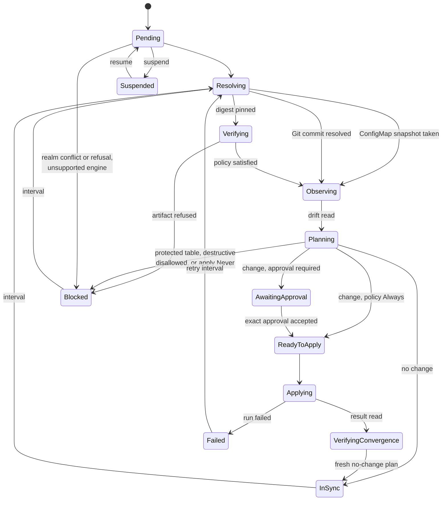
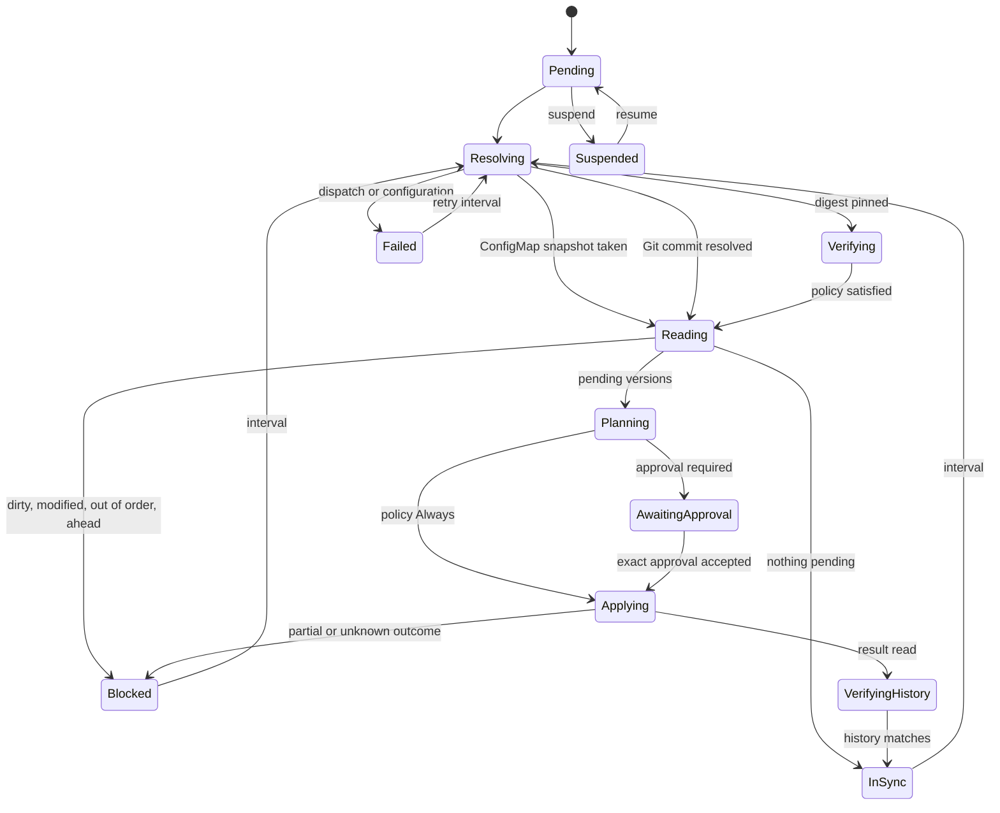

Both families converge a database towards what a resource declares, and they
do it differently enough that the two lifecycles are described side by side
rather than merged. What the operator is put together from is
[Architecture](../architecture/); what enforces each promise, per family, is
[Execution guarantees](../guarantees/).

## The schema lifecycle

Five operations run as Jobs: `Resolve`, `Verify`, `Observe`, `Plan`, `Apply`.
Approval is not an operation — it is a phase in which nothing runs.

- **Resolve** records the immutable digest behind the requested OCI reference.
- **Verify** evaluates the selected policy and independently inspects the
  digest-pinned artifact type.
- **Observe** fetches the verified schema by digest and validates a raw,
  read-only drift report. The report's detail stays inside the runner: status
  receives a digest, a dialect, a total count, the highest severity, and
  bounded category-level aggregates.
- **Plan** performs two independent native scoped plans while holding the
  database-realm Lease, accepts only byte-identical results, and then makes the
  native Apply path parse and dry-run those exact bytes. A no-change result is
  the authoritative statement that the database converged; changed bytes are
  published.
- **Apply** reconstructs and hashes the published bytes immediately before
  executing them.

### A ConfigMap source

A schema or a migration whose `configMap` names its files reaches no registry,
and two of the operations above change for it. Resolve is not a Job: the
manager reads the ConfigMap from the API server, takes the selected keys as
files, and copies them into an immutable snapshot ConfigMap named
`ptah-src-<hash>` that the resource owns, with a manifest of every file's path,
size and SHA-256 beside them. The content digest is the SHA-256 of that
manifest, so the same files give the same digest whatever key they came from.
There is no verification policy for such a source, so there is no Verify step
and no `ArtifactVerified` condition; `ArtifactResolved` says
`SnapshotTaken`.

Every later operation that reads the files mounts the snapshot, never the
source ConfigMap. An init container in the Pod checks the snapshot against the
content digest the operation was bound to, refuses one whose manifest or any
file no longer gives it, and only then copies the files where the operation
container reads them. A refusal stops the Pod before the container that holds
the database URL starts, and the init container's status says which file
failed.

An edit to the source ConfigMap is read at once rather than at the next
interval. An edit to a key the source does not select gives the same content
digest, keeps the snapshot and the plan, and plans nothing new; an edit to a
selected key gives a new snapshot and retires the plan. A plan binds the
ConfigMap's UID and the content digest in place of an artifact digest, under
plan contract version 2, so another ConfigMap with the same name retires it
too. The manager deletes a snapshot once nothing names it any more.

If a snapshot is deleted or replaced while an operation still needs it, that
operation is refused rather than read from anywhere else. Putting back the
exact bytes, or editing the source so that it is read again once nothing is in
flight, lets it continue.

### A Git source

A schema or a migration whose `git` names a repository, a ref and a path
reaches it only from Jobs, through Ptah's pull. Resolve is a Job that fetches
the commit the ref names, a branch at its tip, a tag at the commit it names,
or a commit by its id, and reports that commit and the content digest of the
selected files, computed as for a ConfigMap source. The status records the
repository, ref and path it answered beside them. There is no verification
policy for such a source, so there is no Verify step and no
`ArtifactVerified` condition; `ArtifactResolved` says `CommitResolved` and
names the commit.

Every later operation that reads the files fetches that commit again, in an
init container that holds the credential, and refuses content other than the
recorded digest: Ptah's pull is held to it, and the runner reads back what Ptah
wrote and checks it again before it copies the files where the operation
container reads them. The commit is fetched by the ref that named it while the
ref still points there, and by its id afterwards where the server allows it; a
commit that is no longer reachable, because the branch was force-pushed, is
refused, and the next Resolve reads the ref again.

A branch or a tag is read again at every interval. A commit that leaves the
selected files as they were keeps the plan; other files retire it. A plan
binds the SHA-256 of the repository URL and the path, with the content digest,
in place of an artifact digest, under plan contract version 2, so another
repository or path retires it even when the files match.

After an Apply, `Observe` and `Plan` run again under the original Apply Lease.
Only a new, coherent no-change plan establishes convergence: a process exit
never establishes that the database changed the way the plan said it would.

### Blocked is a refusal, not a fault

`Blocked` means the answer will not change until somebody changes an input. It
is reached from seven places: a realm conflict, a `PtahRealm` that does not
admit the resource, an unsupported engine, a
verification policy that refused the artifact, a plan that would change a
a protected table, a destructive plan the policy disallows, and `apply: Never`,
which is not a problem at all — it is the policy that records plans and applies
none, and a resource can sit there for as long as somebody wants. `Failed` is
different again: something went wrong and a retry is reasonable.

A blocked resource still refreshes on its interval through the complete
Resolve → Verify → Observe → Plan pipeline, so a policy edit or a new artifact
is noticed without anybody touching the resource.

### Suspended, and losing a lock

`spec.suspend` prevents new Jobs. A Job already applying is still observed to a
terminal result, because abandoning it would leave the database in a state
nothing recorded; suspension while an operation is live stages the Lease
release first.

`leaseContinuityLost` is set before any result can be harvested when the
persisted epoch no longer owns an uninterrupted lock interval. A result
produced across an epoch change is discarded rather than read: the lock it held
was somebody else's by then.

## The migration lifecycle

Four operations run as Jobs: `Resolve`, `Verify`, `History`, `Apply`. Only
`Apply` takes the database-realm Lease; reading history does not, because it
mutates nothing. A migration directory held in a ConfigMap is resolved by the
manager into a snapshot, as [a schema's is](#a-configmap-source), and both
`History` and `Apply` read the checked snapshot. One held in Git is resolved by
a Job and fetched again by both, as [a schema's is](#a-git-source).

Reading the history produces one of six verdicts, and the operator never
guesses at any of them: the revision table is dirty; a recorded migration's
checksum no longer matches the artifact; a pending version sorts below one
already applied; the database is ahead of the artifact; nothing is pending; or
a sequence is ready to plan. Pending selection is Ptah's own list rather than a
subtraction of counts, because a checkpoint bootstrap makes those two answers
differ.

The two ways out of the ordinary path are the same two words the schema path
uses, and they mean the same thing here. `Blocked` is a verdict about the
database that will not change on its own; `Failed` is a configuration or
dispatch failure the controller could not resolve by retrying immediately, and
it retries on its own interval.

An outcome that is `Partial` or `Unknown` refuses every later Apply until the
database itself settles it. The resource goes to `Blocked`, and only a history
reading that shows nothing pending releases it — never a retry, because
replaying a non-idempotent statement is exactly the damage the refusal exists to
prevent. Every other outcome is confirmed by reading the history back in
`VerifyingHistory`.

An `Apply` runs the approved sequence and nothing else. The Job carries the
sequence, and Ptah compares it with its own selection under the migration lock,
the moment every earlier check is behind it. Any difference refuses the run
before it changes anything, which reads as `Failed` with nothing applied: a
history restored backwards after the approval is caught there rather than
executed.

Adoption of an existing schema is deliberately not an operator feature: an
empty revision table reads as everything pending, and the answer is Ptah's own
`migrations baseline`, run by a person against a shadow database. The operator
never holds a shadow credential.
